# STM32F407VG 引脚配置与使能 · 超级详细指南

> **数据来源**：ST 官方数据手册《STM32F405xx / STM32F407xx》（DS8626 Rev 12）——§3 功能概述（p.14 起）、§4 Pinouts and pin description（p.43 起，Figure 13 LQFP100 pinout 在 p.44，Table 7 逐脚定义在 p.49-61，Table 9 复用功能映射在 p.64-70）、§6 Electrical characteristics（p.78 起）。
>
> **适用芯片**：STM32F407VGTx（V = 100 脚，G = 1MB Flash，T = LQFP，x = 温度后缀）——LQFP100 封装、ARM Cortex-M4F 带 FPU、主频可达 168 MHz。
>
> **本仓库上下文**：`stm32f407-blink` 是裸机 + FreeRTOS 的 HAL 工程（Makefile 定义 `-DSTM32F407xx`，链接脚本 `STM32F407VGTx_FLASH.ld`），LED 接在 **PD12**（见 `Core/Inc/main.h` 中 `LED_Pin = GPIO_PIN_12`、`LED_GPIO_Port = GPIOD`，`main.c` 中 `HAL_GPIO_TogglePin` 500 ms 翻转）。本文所有「如何使能」示例都与本工程代码逐行对齐。

---

## 目录

- [1. 芯片与引脚总览](#1-芯片与引脚总览)
- [2. 物理管脚布局图（LQFP100 俯视图）](#2-物理管脚布局图lqfp100-俯视图)
- [3. 全部 100 个物理引脚逐脚详解（LQFP100 主表）](#3-全部-100-个物理引脚逐脚详解lqfp100-主表)
- [4. GPIO 模式与寄存器详解](#4-gpio-模式与寄存器详解)
- [5. 时钟系统与外设使能](#5-时钟系统与外设使能)
- [6. 启动模式与 BOOT 配置](#6-启动模式与-boot-配置)
- [7. 复用功能 AF0~AF15 映射](#7-复用功能-af0af15-映射)
- [8. 调试口：SWJ-DP（PA13/PA14/PA15/PB3/PB4）](#8-调试口swj-dppa13pa14pa15pb3pb4)
- [9. 电气特性](#9-电气特性)
- [10. 上电复位与 BOR/PVD](#10-上电复位与-borpvd)
- [11. 如何使能一个 GPIO](#11-如何使能一个-gpio)
- [12. Blink 实战：本仓库 main.c 的 PD12 深度分析](#12-blink-实战本仓库-mainc-的-pd12-深度分析)
- [13. 常见坑 FAQ](#13-常见坑-faq)

---

## 1. 芯片与引脚总览

| 项目 | 参数 |
| --- | --- |
| 封装 | **LQFP100**（0.5 mm 间距，14 × 14 mm 体），共 **100 个物理引脚**（DS8626 Figure 13, p.44；封装尺寸 §7.4, p.172） |
| 内核 | ARM **Cortex-M4F**（带硬件 FPU 单精度 + DSP 指令 + ART 加速器），最高 **168 MHz**（Table 14, p.81） |
| Flash | **1 MB**（地址 `0x0800 0000` ~ `0x080F FFFF`，内存映射 p.73） |
| SRAM | **112 KB 主 SRAM + 16 KB CCM 辅助 SRAM（0x2000 0000 域）+ 64 KB CCM 数据 RAM（`0x1000 0000`，p.73）** |
| GPIO 总数 | LQFP100 引出 **82 个 GPIO**：PA0~15、PB0~15、PC0~15、PD0~15、PE0~15 各 16 个 + PH0/PH1（晶振脚） |
| 5V 容忍脚 | **80 个 FT 类 I/O**（除 PA4/PA5 为 TTa 直连 ADC 外全部 GPIO 均为 FT）；NRST 同样可承受 5.5 V（Table 11, p.80） |
| ADC | 3 个 12 位 ADC：IN0~IN15 分布在 PA0~PA7、PB0/PB1、PC0~PC5（附加功能，不经 AFR） |
| DAC | 2 通道：OUT1=PA4、OUT2=PA5（Table 7, p.52） |
| 定时器 | TIM1/TIM8 高级、TIM2~TIM5/TIM9~TIM14 通用——输出通道映射见第 7 章大表 |
| USB | USB **OTG FS**（PA8~PA12，Device/Host/OTG）；USB **OTG HS** 需外接 ULPI PHY（PC0/PC2/PC3 + PA3/PB0~PB5/PB10~PB13，AF10） |
| 通信 | USART1/2/3/6、UART4/5；SPI1/2/3；I2C1/2/3；CAN1/CAN2；SDIO（AF12）；以太网 MAC（AF11，LQFP100 上可引出） |
| 晶振 | HSE 主晶振 4~26 MHz 接 **PH0/OSC_IN（Pin 12）、PH1/OSC_OUT（Pin 13）**；LSE 32.768 kHz 接 **PC14/PC15（Pin 8/9）**（Table 32/33, p.103-104） |
| Boot | BOOT0 = **专用引脚（Pin 94）**；BOOT1 由 **PB2**（Pin 35，引脚名写作 `PB2/BOOT1`，Table 7 p.52）提供，见第 6 章 |
| 调试 | SWD：**PA13=SWDIO（Pin 72）、PA14=SWCLK（Pin 76）**；JTAG 增加 PA15/PB3/PB4（复位后默认被 SWJ-DP 占用为 AF0） |
| 板级参考 | 本工程 LED=PD12 与 ST 官方 STM32F4-Discovery 板载绿 LED（LD3）一致；Discovery 板载 4 灯 PD12/13/14/15、用户按键 PA0 |

### 1.1 引脚分类一图流

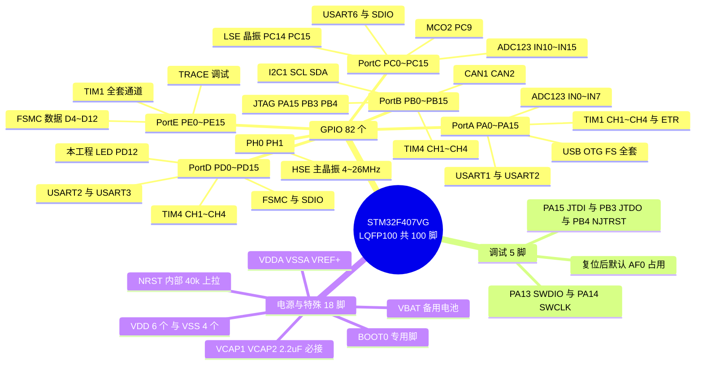

### 1.2 引脚类型占比

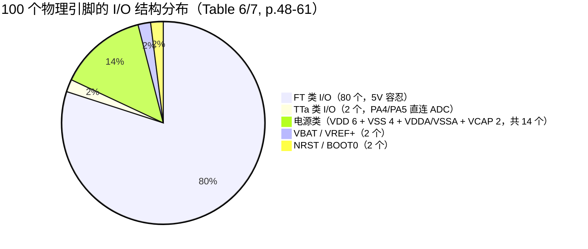

> 📌 两个关键点：① F4 的 GPIO 名义上有 114 个（PA~PI），LQFP100 只引出 **82 个**，但 USART/SPI/I2C/定时器的多路复用设计让「常用外设」几乎都能在这 82 个脚上找到位置（第 7 章）；② 82 个 GPIO 里只有 **PA4、PA5 不是 5V 容忍**（TTa 结构，直连 ADC/DAC，Table 7 p.52），其余全部 FT——这一点与 F1 系列「FT 脚稀少」完全不同。

---

## 2. 物理管脚布局图（LQFP100 俯视图）

下图对应数据手册 **Figure 13「STM32F40xxx LQFP100 pinout」（DS8626 p.44）**。LQFP100 从左上角 Pin 1（有圆点标记）开始**逆时针**编号：左侧 1~25、底部 26~50、右侧 51~75、顶部 76~100。每个节点为「引脚号 + 引脚名 + 关键复用」。

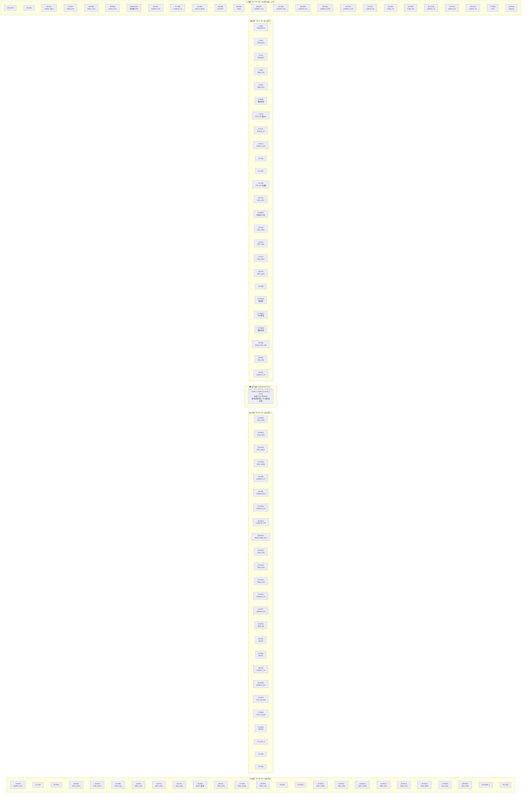

> ⚠️ 底边注意 Pin 27/28 是一对 VSS/VDD（夹在 PA3 与 PA4 之间）；左边的 PC15 与底边的 PB2 之间隔着 PE 端口——PE7~PE15 全部集中在底部 36~46 区。核对依据：Figure 13（p.44）与 Table 7 的 LQFP100 列（p.49-61）逐脚一致。

---

## 3. 全部 100 个物理引脚逐脚详解（LQFP100 主表）

下表整合 DS8626 **Table 7「STM32F40xxx pin and ball definitions」（p.49-61，取 LQFP100 列）** 与 **Table 9 复用功能映射（p.64-70）**。缩写含义（Table 6, p.48）：

| 缩写 | 含义 |
| --- | :-: |
| `S` | 电源脚（Supply） |
| `I/O` | 输入/输出脚 |
| `FT` | **5V 容忍 I/O**（Five-volt Tolerant），绝对最大 VDD+4.0 V（Table 11, p.80） |
| `TTa` | 3.3V 容忍、直连 ADC 的 I/O（仅 PA4/PA5），最大 VDDA+0.3 V |
| `B` | 专用 BOOT0 脚（不可作 GPIO） |
| `RST` | 双向复位脚，内置约 40 kΩ 永久上拉（§6.3.17, p.121） |
| `AFn` | 通过 GPIOx_AFR 寄存器选择的复用功能（AF 编号见第 7 章） |
| 「附加」 | 经外设寄存器直接使能的功能（ADC 通道 / OSC / WKUP / RTC_AF 等，不占 AFR） |

| 引脚号 | 名称 | 类型 | 结构 | 主功能（复位后） | 关键复用功能（AF 编号） | 附加功能 | 说明 |
| :-: | --- | :-: | :-: | --- | --- | --- | --- |
| 1 | **PE2** | I/O | FT | 浮空输入 | TRACECLK AF0 / ETH_MII_TXD3 AF11 / FSMC_A23 AF12 / EVENTOUT AF15 | — | TRACE 调试时钟脚 |
| 2 | **PE3** | I/O | FT | 浮空输入 | TRACED0 AF0 / FSMC_A19 AF12 / EVENTOUT AF15 | — | TRACE 数据 0 |
| 3 | **PE4** | I/O | FT | 浮空输入 | TRACED1 AF0 / FSMC_A20 AF12 / DCMI_D4 AF13 / EVENTOUT AF15 | — | TRACE 数据 1 |
| 4 | **PE5** | I/O | FT | 浮空输入 | TRACED2 AF0 / TIM9_CH1 AF3 / FSMC_A21 AF12 / DCMI_D6 AF13 / EVENTOUT AF15 | — | TRACE 数据 2 |
| 5 | **PE6** | I/O | FT | 浮空输入 | TRACED3 AF0 / TIM9_CH2 AF3 / FSMC_A22 AF12 / DCMI_D7 AF13 / EVENTOUT AF15 | — | TRACE 数据 3 |
| 6 | **VBAT** | S | — | — | — | — | 备份域电源 1.65~3.6 V（Table 14, p.81）；不用 RTC 备份时与 VDD 短接 |
| 7 | **PC13** | I/O | FT | 浮空输入 | EVENTOUT AF15 | RTC_OUT、RTC_TAMP1、RTC_TS | ⚠ 经电源开关供电：只能 ±3 mA、输出 ≤2 MHz、负载 ≤30 pF，**禁止驱动 LED**（Table 49 注 1, p.118） |
| 8 | **PC14** | I/O | FT | 浮空输入 | EVENTOUT AF15 | OSC32_IN | LSE 32.768 kHz 晶振输入；不用 LSE 时可作 GPIO（同受 3 mA 限制） |
| 9 | **PC15** | I/O | FT | 浮空输入 | EVENTOUT AF15 | OSC32_OUT | LSE 晶振输出；同上 3 mA 限制 |
| 10 | **VSS** | S | — | — | — | — | 数字地 1（Table 7, p.50） |
| 11 | **VDD** | S | — | — | — | — | 数字电源 1：1.8~3.6 V |
| 12 | **PH0** | I/O | FT | 浮空输入 | EVENTOUT AF15 | OSC_IN | **HSE 主晶振输入**（4~26 MHz 晶振或 1~50 MHz 外部时钟，Table 30/32, p.101-103）；不用 HSE 可作 GPIO |
| 13 | **PH1** | I/O | FT | 浮空输入 | EVENTOUT AF15 | OSC_OUT | HSE 晶振输出；同上 |
| 14 | **NRST** | I/O | RST | 复位（低有效） | — | — | 内置约 40 kΩ 上拉 + 100 ns 滤波（Table 51, p.121）；建议外接 0.1 µF |
| 15 | **PC0** | I/O | FT | 浮空输入 | OTG_HS_ULPI_STP AF10 / EVENTOUT AF15 | ADC123_IN10 | ULPI PHY 控制脚（OTG HS） |
| 16 | **PC1** | I/O | FT | 浮空输入 | ETH_MDC AF11 / EVENTOUT AF15 | ADC123_IN11 | 以太网管理时钟 |
| 17 | **PC2** | I/O | FT | 浮空输入 | SPI2_MISO / I2S2ext_SD AF5 / OTG_HS_ULPI_DIR AF10 / ETH_MII_TXD2 AF11 / EVENTOUT AF15 | ADC123_IN12 | SPI2 复用走 PC2/PB14 二选一 |
| 18 | **PC3** | I/O | FT | 浮空输入 | SPI2_MOSI / I2S2_SD AF5 / OTG_HS_ULPI_NXT AF10 / ETH_MII_TX_CLK AF11 / EVENTOUT AF15 | ADC123_IN13 | 同上，SPI2 走线灵活 |
| 19 | **VDD** | S | — | — | — | — | 数字电源 2 |
| 20 | **VSSA** | S | — | — | — | — | **模拟地**：必须与 VSS 同电位（Table 11 注 1, p.80） |
| 21 | **VREF+** | S | — | — | — | — | ADC/DAC 参考正端；必须满足 VDDA−VREF+ < 1.2 V（Table 14 注 4, p.82） |
| 22 | **VDDA** | S | — | — | — | — | **模拟电源 1.8~3.6 V**：ADC/PLL/复位电路供电；与 VDD 压差上电期间 ≤300 mV（Table 14 注 5, p.82） |
| 23 | **PA0** | I/O | FT | 浮空输入 | TIM2_CH1_ETR AF1 / TIM5_CH1 AF2 / TIM8_ETR AF3 / USART2_CTS AF7 / UART4_TX AF8 / ETH_MII_CRS·RMII_REF_CLK AF11 / EVENTOUT AF15 | **ADC123_IN0、WKUP** | ⭐ 唯一 WKUP 唤醒脚；Discovery 板用户按键 |
| 24 | **PA1** | I/O | FT | 浮空输入 | TIM2_CH2 AF1 / TIM5_CH2 AF2 / USART2_RTS AF7 / UART4_RX AF8 / ETH_RMII_REF_CLK·MII_RX_CLK AF11 / EVENTOUT AF15 | ADC123_IN1 | ADC 通道 1 |
| 25 | **PA2** | I/O | FT | 浮空输入 | TIM2_CH3 AF1 / TIM5_CH3 AF2 / TIM9_CH1 AF3 / USART2_TX AF7 / ETH_MDIO AF11 / EVENTOUT AF15 | ADC123_IN2 | 常用串口 TX |
| 26 | **PA3** | I/O | FT | 浮空输入 | TIM2_CH4 AF1 / TIM5_CH4 AF2 / TIM9_CH2 AF3 / USART2_RX AF7 / OTG_HS_ULPI_D0 AF10 / ETH_MII_COL AF11 / EVENTOUT AF15 | ADC123_IN3 | 常用串口 RX |
| 27 | **VSS** | S | — | — | — | — | 数字地 2 |
| 28 | **VDD** | S | — | — | — | — | 数字电源 3 |
| 29 | **PA4** | I/O | **TTa** | 浮空输入 | SPI1_NSS AF5 / SPI3_NSS·I2S3_WS AF6 / USART2_CK AF7 / OTG_HS_SOF AF10 / DCMI_HSYNC AF13 / EVENTOUT AF15 | **ADC12_IN4、DAC_OUT1** | ⚠ 非 5V 容忍（直连 ADC/DAC）；DAC 通道 1 |
| 30 | **PA5** | I/O | **TTa** | 浮空输入 | TIM2_CH1_ETR AF1 / TIM8_CH1N AF3 / SPI1_SCK AF5 / OTG_HS_ULPI_CK AF10 / EVENTOUT AF15 | **ADC12_IN5、DAC_OUT2** | ⚠ 非 5V 容忍；DAC 通道 2 |
| 31 | **PA6** | I/O | FT | 浮空输入 | TIM1_BKIN AF1 / TIM3_CH1 AF2 / TIM8_BKIN AF3 / SPI1_MISO AF5 / TIM13_CH1 AF9 / DCMI_PIXCLK AF13 / EVENTOUT AF15 | ADC12_IN6 | SPI1 MISO |
| 32 | **PA7** | I/O | FT | 浮空输入 | TIM1_CH1N AF1 / TIM3_CH2 AF2 / TIM8_CH1N AF3 / SPI1_MOSI AF5 / TIM14_CH1 AF9 / ETH_MII_RX_DV·RMII_CRS_DV AF11 / EVENTOUT AF15 | ADC12_IN7 | SPI1 MOSI |
| 33 | **PB0** | I/O | FT | 浮空输入 | TIM1_CH2N AF1 / TIM3_CH3 AF2 / TIM8_CH2N AF3 / OTG_HS_ULPI_D1 AF10 / ETH_MII_RXD2 AF11 / EVENTOUT AF15 | ADC12_IN8 | ADC 通道 8 |
| 34 | **PB1** | I/O | FT | 浮空输入 | TIM1_CH3N AF1 / TIM3_CH4 AF2 / TIM8_CH3N AF3 / OTG_HS_ULPI_D2 AF10 / ETH_MII_RXD3 AF11 / EVENTOUT AF15 | ADC12_IN9 | ADC 通道 9 |
| 35 | **PB2** | I/O | FT | 浮空输入 | EVENTOUT AF15 | — | ⚠ 引脚名 **PB2/BOOT1**（Table 7, p.52）：复位时该脚电平作为 BOOT1 采样（见第 6 章）；平时可作普通 GPIO |
| 36 | **PE7** | I/O | FT | 浮空输入 | TIM1_ETR AF1 / FSMC_D4 AF12 / EVENTOUT AF15 | — | FSMC 数据总线起点 |
| 37 | **PE8** | I/O | FT | 浮空输入 | TIM1_CH1N AF1 / FSMC_D5 AF12 / EVENTOUT AF15 | — | — |
| 38 | **PE9** | I/O | FT | 浮空输入 | TIM1_CH1 AF1 / FSMC_D6 AF12 / EVENTOUT AF15 | — | — |
| 39 | **VSS** | S | — | — | — | — | 数字地 3 |
| 40 | **VDD** | S | — | — | — | — | 数字电源 4 |
| 41 | **PE10** | I/O | FT | 浮空输入 | TIM1_CH2N AF1 / FSMC_D7 AF12 / EVENTOUT AF15 | — | — |
| 42 | **PE11** | I/O | FT | 浮空输入 | TIM1_CH2 AF1 / FSMC_D8 AF12 / EVENTOUT AF15 | — | — |
| 43 | **PE12** | I/O | FT | 浮空输入 | TIM1_CH3N AF1 / FSMC_D9 AF12 / EVENTOUT AF15 | — | — |
| 44 | **PE13** | I/O | FT | 浮空输入 | TIM1_CH3 AF1 / FSMC_D10 AF12 / EVENTOUT AF15 | — | — |
| 45 | **PE14** | I/O | FT | 浮空输入 | TIM1_CH4 AF1 / FSMC_D11 AF12 / EVENTOUT AF15 | — | — |
| 46 | **PE15** | I/O | FT | 浮空输入 | TIM1_BKIN AF1 / FSMC_D12 AF12 / EVENTOUT AF15 | — | — |
| 47 | **PB10** | I/O | FT | 浮空输入 | TIM2_CH3 AF1 / I2C2_SCL AF4 / SPI2_SCK·I2S2_CK AF5 / USART3_TX AF7 / OTG_HS_ULPI_D3 AF10 / ETH_MII_RX_ER AF11 / EVENTOUT AF15 | — | I2C2 与 SPI2 双复用 |
| 48 | **PB11** | I/O | FT | 浮空输入 | TIM2_CH4 AF1 / I2C2_SDA AF4 / USART3_RX AF7 / OTG_HS_ULPI_D4 AF10 / ETH_RMII_TX_EN·MII_TX_EN AF11 / EVENTOUT AF15 | — | I2C2 SDA |
| 49 | **VCAP_1** | S | — | — | — | — | 内核 1.2 V 稳压器输出 1：**必须接 2.2 µF 陶瓷电容（ESR<2Ω）到 GND**（Table 16, p.84） |
| 50 | **VDD** | S | — | — | — | — | 数字电源 5 |
| 51 | **PB12** | I/O | FT | 浮空输入 | TIM1_BKIN AF1 / I2C2_SMBA AF4 / SPI2_NSS·I2S2_WS AF5 / USART3_CK AF7 / CAN2_RX AF9 / OTG_HS_ULPI_D5·OTG_HS_ID AF10 / ETH_RMII_TXD0·MII_TXD0 AF11 / EVENTOUT AF15 | — | 复用极多，注意冲突 |
| 52 | **PB13** | I/O | FT | 浮空输入 | TIM1_CH1N AF1 / SPI2_SCK·I2S2_CK AF5 / USART3_CTS AF7 / CAN2_TX AF9 / OTG_HS_ULPI_D6·OTG_HS_VBUS AF10 / ETH_RMII_TXD1·MII_TXD1 AF11 / EVENTOUT AF15 | — | bootloader 也用 PB5/PB13 跑 CAN2 |
| 53 | **PB14** | I/O | FT | 浮空输入 | TIM1_CH2N AF1 / TIM8_CH2N AF3 / SPI2_MISO·I2S2ext_SD AF5 / USART3_RTS AF7 / TIM12_CH1 AF9 / EVENTOUT AF15 | — | — |
| 54 | **PB15** | I/O | FT | 浮空输入 | RTC_REFIN AF0 / TIM1_CH3N AF1 / TIM8_CH3N AF3 / SPI2_MOSI·I2S2_SD AF5 / TIM12_CH2 AF9 / OTG_HS_DP AF10 / EVENTOUT AF15 | — | 51 Hz RTC 参考时钟输入 |
| 55 | **PD8** | I/O | FT | 浮空输入 | USART3_TX AF7 / FSMC_D13 AF12 / EVENTOUT AF15 | — | — |
| 56 | **PD9** | I/O | FT | 浮空输入 | USART3_RX AF7 / FSMC_D14 AF12 / EVENTOUT AF15 | — | — |
| 57 | **PD10** | I/O | FT | 浮空输入 | USART3_CK AF7 / FSMC_D15 AF12 / EVENTOUT AF15 | — | — |
| 58 | **PD11** | I/O | FT | 浮空输入 | USART3_CTS AF7 / FSMC_A16·CLE AF12 / EVENTOUT AF15 | — | — |
| 59 | **PD12** | I/O | FT | 浮空输入 | **TIM4_CH1 AF2** / USART3_RTS AF7 / FSMC_A17 AF12 / EVENTOUT AF15 | — | ⭐ **本工程 LED 脚**（STM32F4-Discovery 板载绿 LED）；深度分析见第 12 章 |
| 60 | **PD13** | I/O | FT | 浮空输入 | TIM4_CH2 AF2 / FSMC_A18 AF12 / EVENTOUT AF15 | — | Discovery 板载橙 LED |
| 61 | **PD14** | I/O | FT | 浮空输入 | TIM4_CH3 AF2 / FSMC_D0 AF12 / EVENTOUT AF15 | — | Discovery 板载红 LED |
| 62 | **PD15** | I/O | FT | 浮空输入 | TIM4_CH4 AF2 / FSMC_D1 AF12 / EVENTOUT AF15 | — | Discovery 板载蓝 LED |
| 63 | **PC6** | I/O | FT | 浮空输入 | TIM3_CH1 AF2 / TIM8_CH1 AF3 / I2S2_MCK AF5 / USART6_TX AF7 / SDIO_D6 AF12 / DCMI_D0 AF13 / EVENTOUT AF15 | — | USART6 在 LQFP100 上只有 PC6/PC7 可用 |
| 64 | **PC7** | I/O | FT | 浮空输入 | TIM3_CH2 AF2 / TIM8_CH2 AF3 / I2S3_MCK AF6 / USART6_RX AF7 / SDIO_D7 AF12 / DCMI_D1 AF13 / EVENTOUT AF15 | — | — |
| 65 | **PC8** | I/O | FT | 浮空输入 | TIM3_CH3 AF2 / TIM8_CH3 AF3 / USART6_CK AF7 / SDIO_D0 AF12 / DCMI_D2 AF13 / EVENTOUT AF15 | — | — |
| 66 | **PC9** | I/O | FT | 浮空输入 | MCO2 AF0 / TIM3_CH4 AF2 / TIM8_CH4 AF3 / I2C3_SDA AF4 / I2S_CKIN AF5 / SDIO_D1 AF12 / DCMI_D3 AF13 / EVENTOUT AF15 | — | MCO2 可输出 SYSCLK/PLL 等 |
| 67 | **PA8** | I/O | FT | 浮空输入 | MCO1 AF0 / TIM1_CH1 AF1 / I2C3_SCL AF4 / USART1_CK AF7 / OTG_FS_SOF AF10 / EVENTOUT AF15 | — | MCO1 输出 HSI/LSE/HSE/PLL |
| 68 | **PA9** | I/O | FT | 浮空输入 | TIM1_CH2 AF1 / I2C3_SMBA AF4 / USART1_TX AF7 / OTG_FS_VBUS AF10 / DCMI_D0 AF13 / EVENTOUT AF15 | — | ⭐ 系统 bootloader 串口 TX（USART1） |
| 69 | **PA10** | I/O | FT | 浮空输入 | TIM1_CH3 AF1 / USART1_RX AF7 / OTG_FS_ID AF10 / DCMI_D1 AF13 / EVENTOUT AF15 | — | ⭐ bootloader 串口 RX；内部上拉为 7~14 kΩ（OTG ID 专用阻值，Table 48, p.117） |
| 70 | **PA11** | I/O | FT | 浮空输入 | TIM1_CH4 AF1 / USART1_CTS AF7 / CAN1_RX AF9 / **OTG_FS_DM AF10** / EVENTOUT AF15 | — | USB FS D−；bootloader USB DFU 数据脚 |
| 71 | **PA12** | I/O | FT | 浮空输入 | TIM1_ETR AF1 / USART1_RTS AF7 / CAN1_TX AF9 / **OTG_FS_DP AF10** / EVENTOUT AF15 | — | USB FS D+ |
| 72 | **PA13** | I/O | FT | 浮空输入 | **JTMS-SWDIO AF0** / EVENTOUT AF15 | — | ⭐ SWD 数据脚，复位后即被 SWJ-DP 占用（AF0） |
| 73 | **VCAP_2** | S | — | — | — | — | 内核 1.2 V 稳压器输出 2：必须接 2.2 µF |
| 74 | **VSS** | S | — | — | — | — | 数字地 4 |
| 75 | **VDD** | S | — | — | — | — | 数字电源 6 |
| 76 | **PA14** | I/O | FT | 浮空输入 | **JTCK-SWCLK AF0** / EVENTOUT AF15 | — | ⭐ SWD 时钟脚，复位后即被 SWJ-DP 占用 |
| 77 | **PA15** | I/O | FT | 浮空输入 | **JTDI AF0** / TIM2_CH1_ETR AF1 / SPI1_NSS AF5 / SPI3_NSS·I2S3_WS AF6 / EVENTOUT AF15 | — | JTAG 数据输入；不用 JTAG 时可释放为 GPIO |
| 78 | **PC10** | I/O | FT | 浮空输入 | SPI3_SCK·I2S3_CK AF6 / USART3_TX AF7 / UART4_TX AF8 / SDIO_D2 AF12 / DCMI_D8 AF13 / EVENTOUT AF15 | — | SPI3/SPI 双复用典型脚 |
| 79 | **PC11** | I/O | FT | 浮空输入 | SPI3_MISO·I2S3ext_SD AF6 / USART3_RX AF7 / UART4_RX AF8 / SDIO_D3 AF12 / DCMI_D4 AF13 / EVENTOUT AF15 | — | — |
| 80 | **PC12** | I/O | FT | 浮空输入 | SPI3_MOSI·I2S3_SD AF6 / USART3_CK AF7 / UART5_TX AF8 / SDIO_CK AF12 / DCMI_D9 AF13 / EVENTOUT AF15 | — | — |
| 81 | **PD0** | I/O | FT | 浮空输入 | CAN1_RX AF9 / FSMC_D2 AF12 / EVENTOUT AF15 | — | — |
| 82 | **PD1** | I/O | FT | 浮空输入 | CAN1_TX AF9 / FSMC_D3 AF12 / EVENTOUT AF15 | — | — |
| 83 | **PD2** | I/O | FT | 浮空输入 | TIM3_ETR AF2 / UART5_RX AF8 / **SDIO_CMD AF12** / DCMI_D11 AF13 / EVENTOUT AF15 | — | SD 卡命令线 |
| 84 | **PD3** | I/O | FT | 浮空输入 | USART2_CTS AF7 / FSMC_CLK AF12 / EVENTOUT AF15 | — | — |
| 85 | **PD4** | I/O | FT | 浮空输入 | USART2_RTS AF7 / FSMC_NOE AF12 / EVENTOUT AF15 | — | — |
| 86 | **PD5** | I/O | FT | 浮空输入 | USART2_TX AF7 / FSMC_NWE AF12 / EVENTOUT AF15 | — | — |
| 87 | **PD6** | I/O | FT | 浮空输入 | USART2_RX AF7 / FSMC_NWAIT AF12 / EVENTOUT AF15 | — | — |
| 88 | **PD7** | I/O | FT | 浮空输入 | USART2_CK AF7 / FSMC_NE1·NCE2 AF12 / EVENTOUT AF15 | — | — |
| 89 | **PB3** | I/O | FT | 浮空输入 | **JTDO-TRACESWO AF0** / TIM2_CH2 AF1 / SPI1_SCK AF5 / SPI3_SCK·I2S3_CK AF6 / EVENTOUT AF15 | — | JTAG 输出；可释放为 SPI1 SCK |
| 90 | **PB4** | I/O | FT | 浮空输入 | **NJTRST AF0** / TIM3_CH1 AF2 / SPI1_MISO AF5 / SPI3_MISO·I2S3ext_SD AF6 / EVENTOUT AF15 | — | JTRST；可释放为 TIM3/SPI |
| 91 | **PB5** | I/O | FT | 浮空输入 | I2C1_SMBA AF4 / TIM3_CH2 AF2 / SPI1_MOSI AF5 / SPI3_MOSI·I2S3_SD AF6 / CAN2_RX AF9 / OTG_HS_ULPI_D7 AF10 / ETH_PPS_OUT AF11 / DCMI_D10 AF13 / EVENTOUT AF15 | — | bootloader CAN2 脚之一 |
| 92 | **PB6** | I/O | FT | 浮空输入 | TIM4_CH1 AF2 / I2C1_SCL AF4 / USART1_TX AF7 / CAN2_TX AF9 / DCMI_D5 AF13 / EVENTOUT AF15 | — | I2C1 最常用_SCL |
| 93 | **PB7** | I/O | FT | 浮空输入 | TIM4_CH2 AF1 / I2C1_SDA AF4 / USART1_RX AF7 / FSMC_NL AF12 / DCMI_VSYNC AF13 / EVENTOUT AF15 | — | I2C1 最常用 SDA；TIM4_CH2 也在此脚（AF1） |
| 94 | **BOOT0** | I | **B** | — | — | **VPP** | ⭐ 专用 BOOT0：输入低→主 Flash；输入高→bootloader/SRAM；输入阈值见 Table 48（p.116）；禁电流注入（Table 47, p.116） |
| 95 | **PB8** | I/O | FT | 浮空输入 | TIM4_CH3 AF2 / TIM10_CH1 AF3 / I2C1_SCL AF4 / CAN1_RX AF9 / ETH_MII_TXD3 AF11 / SDIO_D4 AF12 / DCMI_D6 AF13 / EVENTOUT AF15 | — | I2C1 备用 SCL |
| 96 | **PB9** | I/O | FT | 浮空输入 | TIM4_CH4 AF2 / TIM11_CH1 AF3 / I2C1_SDA AF4 / SPI2_NSS·I2S2_WS AF5 / CAN1_TX AF9 / SDIO_D5 AF12 / DCMI_D7 AF13 / EVENTOUT AF15 | — | I2C1 备用 SDA |
| 97 | **PE0** | I/O | FT | 浮空输入 | TIM4_ETR AF2 / FSMC_NBL0 AF12 / DCMI_D2 AF13 / EVENTOUT AF15 | — | — |
| 98 | **PE1** | I/O | FT | 浮空输入 | FSMC_NBL1 AF12 / DCMI_D3 AF13 / EVENTOUT AF15 | — | — |
| 99 | **VSS** | S | — | — | — | — | 数字地（顶部） |
| 100 | **VDD** | S | — | — | — | — | 数字电源（顶部） |

> 注：Pin 93（PB7）的 TIM4_CH2 属 **AF1**（PB7 在 Port B 的 AF1 行，Table 9 p.65）；PD 端口的 TIM4_CH1~CH4 才是 AF2。PDF 提取文本表行有交错，此处已按 Table 7（p.60）逐脚行文交叉核对。
> 引脚号↔名称核对方法：Figure 13（p.44）四边顺序 × Table 7 LQFP100 列（p.49-61）双向一致，例如 `PC2 17 59 PD12`（p.49 提取文本）意为 LQFP64 的 PC2=17、LQFP100 的 PD12=59。

---

## 4. GPIO 模式与寄存器详解

STM32F4 的 GPIO 与 F1 完全不同：**不再有 CRH/CRL 配置寄存器**，改为 4 个 32 位配置寄存器 + 2 个复用选择寄存器（详见 RM0090 第 8 章 GPIO；本节数值含义与 DS8626 Table 50 的速度定义对应）。

### 4.1 信号路径

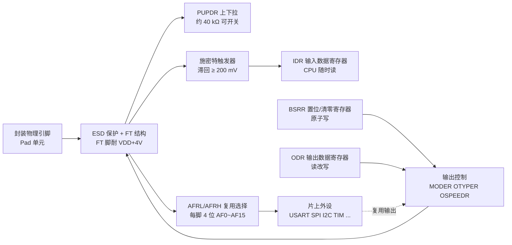

### 4.2 MODER — GPIO 模式寄存器（每脚 2 位）

| MODERy[1:0] | 模式 | 说明 |
| :-: | --- | --- |
| `00` | 输入 | 复位默认值（所有 GPIO），施密特输入经 IDR 可读 |
| `01` | 通用输出 | 输出数据来自 ODR/BSRR；受 OTYPER/OSPEEDR/PUPDR 影响 |
| `10` | 复用功能 | 输出与输入都交给 AFRL/AFRH 选中的外设 |
| `11` | 模拟 | ADC/DAC 用；输入缓冲断开，读 IDR 恒 0（低功耗推荐闲置脚配置） |

### 4.3 OTYPER / OSPEEDR / PUPDR

| 寄存器 | 位宽/脚 | 取值 | 含义 |
| --- | :-: | :-: | --- |
| OTYPER | 1 位/脚 | 0 / 1 | 推挽输出（默认）/ 开漏输出（I2C、线与、5V 总线必用） |
| OSPEEDR | 2 位/脚 | 00 / 01 / 10 / 11 | 低速 / 中速 / 高速 / 超高速（见下表，Table 50, p.119-120） |
| PUPDR | 2 位/脚 | 00 / 01 / 10 | 无上下拉（默认）/ 上拉 / 下拉（11 保留）；阻值 30~50 kΩ，典型 40 kΩ（Table 48, p.117） |

**OSPEEDR 与实际输出频率上限**（Table 50, p.119-120，评估值）：

| OSPEEDR | 50 pF · VDD>2.7 V | 10 pF · VDD>2.7 V | 边沿时间（50 pF） |
| :-: | :-: | :-: | :-: |
| 00 低速 | 4 MHz | 8 MHz | 100 ns |
| 01 中速 | 25 MHz | 50 MHz | 10 ns |
| 10 高速 | 50 MHz（40 pF） | 100 MHz | 6 ns |
| 11 超高速 | 100 MHz（30 pF） | 180 MHz | 2.5 ns |

> 频率 >50 MHz 时应使用补偿单元（compensation cell，SYSCFG_CMPCR，Table 50 注 4）；信号边沿越陡 EMI 越大，**LED/普通控制信号用 00 低速即可**（本工程正是如此）。

### 4.4 IDR / ODR / BSRR — 数据读写与原子操作

| 寄存器 | 作用 | 备注 |
| --- | --- | --- |
| IDR | 读 16 位引脚电平 | 只读；输入脚读前须确保 MODER=00 且未被复用 |
| ODR | 输出数据 16 位 | **读-改-写**，中断环境下有竞态风险 |
| **BSRR** | 低 16 位写 1 = 置位对应脚；高 16 位写 1 = 清零对应脚 | **单周期原子操作**，两半区同时写时低 16 位优先；中断/RTOS 场景必须用它（HAL_GPIO_TogglePin 内部就走 BSRR） |
| LCKR | 位 16=LCKK 锁定键，位 0~15=LCKy | 特定写序列 `1→0→1→读→0` 锁定配置，复位前不可再改；防跑飞误配置 |

### 4.5 AFRL / AFRH — 复用编号（每脚 4 位）

| 寄存器 | 覆盖引脚 | 每脚 4 位值 |
| --- | --- | --- |
| AFRL（GPIOx_AFRL） | 引脚 0~7 | AF0~AF15（4 bit 编码） |
| AFRH（GPIOx_AFRH） | 引脚 8~15 | 同上 |

例如 PD12 在「高半区」：AFRH 的位 [11*4+3 : 11*4] 即 [47:44]。复位后 AF 编号不定值（仅调试脚默认 AF0），**HAL_GPIO_Init 会在配置为 AF 模式时同时写入 AFR**。

### 4.6 GPIO 时钟与复位状态

- GPIO 时钟开关在 **RCC->AHB1ENR** 位 0~8：GPIOAEN~GPIOIEN（RM0090 RCC 章）。**没开时钟前写 GPIO 寄存器全部无效**——这是 F4 新手第一大坑。
- 复位后：所有 GPIO 为浮空输入（MODER=00、无上下拉），只有 SWJ 调试脚例外（AF0，见第 8 章）。
- 闲置脚低功耗处理建议配模拟模式（AN4899，DS p.116 引用）。

---

## 5. 时钟系统与外设使能

### 5.1 本工程实际时钟配置（main.c `SystemClock_Config` 逐行走读）

本工程**没有使用外部晶振**，而是用内部 **HSI 16 MHz** 作 PLL 源（main.c 第 31~53 行）：

```c
osc.OscillatorType = RCC_OSCILLATORTYPE_HSI;   /* 用 HSI 16MHz，不依赖外部晶振 */
osc.PLL.PLLSource  = RCC_PLLSOURCE_HSI;
osc.PLL.PLLM = 16;                             /* 16MHz / 16 = 1MHz（PLL 输入规范 0.95~2.10MHz, p.106） */
osc.PLL.PLLN = 336;                            /* 1MHz × 336 = 336MHz（VCO 规范 100~432MHz） */
osc.PLL.PLLP = RCC_PLLP_DIV2;                  /* 336 / 2 = 168MHz（SYSCLK 上限规范 ≤168MHz） */
osc.PLL.PLLQ = 7;                              /* 336 / 7 = 48MHz，给 USB OTG FS / SDIO / RNG */
clk.SYSCLKSource   = RCC_SYSCLKSOURCE_PLLCLK;
clk.AHBCLKDivider  = RCC_SYSCLK_DIV1;          /* AHB = 168MHz */
clk.APB1CLKDivider = RCC_HCLK_DIV4;            /* APB1 = 42MHz（规范上限 42MHz, Table 14 p.81） */
clk.APB2CLKDivider = RCC_HCLK_DIV2;            /* APB2 = 84MHz（规范上限 84MHz） */
HAL_RCC_ClockConfig(&clk, FLASH_LATENCY_5);    /* 5 个 Flash 等待周期 */
```

配套还有两行关键代码：`__HAL_PWR_VOLTAGESCALING_CONFIG(PWR_REGULATOR_VOLTAGE_SCALE1)`——即 **VOS=1（Scale 1）**。数据手册 Table 14（p.81-82）规定：VOS=0 时 fHCLK 上限 **144 MHz**，VOS=1（内核电压 1.20~1.32 V）才允许 **168 MHz**。所以「168 MHz 必须配 Scale 1 + 5 个等待周期」三位一体。

**Flash 等待周期对照**（§6.3.6, p.86 与 Table 15, p.83）：

| fHCLK | 0~30 | 30~60 | 60~90 | 90~120 | 120~150 | 150~168 MHz |
| :-: | :-: | :-: | :-: | :-: | :-: | :-: |
| 等待周期（VDD 2.7~3.6 V） | 0 | 1 | 2 | 3 | 4 | **5（本工程 FLASH_LATENCY_5）** |

> VDD 2.4~2.7 V 时 168 MHz 需要 6 WS；2.1~2.4 V 需要 7 WS（Table 15, p.83）——低压运行时等待周期数还要加。

### 5.2 时钟树（本工程链路）

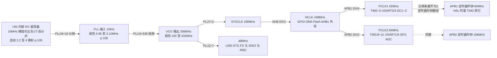

时钟源家族速查（DS8626 §6.3.8-6.3.10, p.101-107）：

| 时钟源 | 频率 | 精度/启动 | 用途 |
| --- | :-: | --- | --- |
| HSI | 16 MHz 固定 | ±1%（25 °C 出厂校准）~ ±4%（-10~85 °C）全温 ±4.5%；启动 2.2~4 µs（Table 34, p.105） | 无晶振方案（本工程）、备用系统时钟 |
| HSE 晶振 | 4~26 MHz | 启动约 2 ms（Table 32, p.103）；负载电容 5~25 pF 按晶振规格配（AN2867） | 高精度主时钟（Discovery 板载 8 MHz 晶振在 PH0/PH1，即 Pin 12/13） |
| HSE 外部时钟 | 1~50 MHz 方波注入 OSC_IN | 占空比 45~55%（Table 30, p.101） | 有源时钟源 |
| LSE | 32.768 kHz | 启动约 2 s（Table 33, p.104） | RTC（PC14/PC15） |
| LSI | 17~47 kHz（典型 32） | RC | IWDG、RTC 备选（Table 35, p.105） |
| PLL | 输入 0.95~2.10 MHz，VCO 100~432 MHz，输出 ≤168 MHz，PLL48 输出 ≤48 MHz（USB 用） | 锁定 75~300 µs（Table 36, p.106-107） | 系统主时钟 |

### 5.3 外设时钟使能位速查（RM0090 RCC 章）

```c
/* GPIO 全在 AHB1： */
RCC->AHB1ENR |= RCC_AHB1ENR_GPIOAEN | RCC_AHB1ENR_GPIOBEN | RCC_AHB1ENR_GPIOCEN
              | RCC_AHB1ENR_GPIODEN | RCC_AHB1ENR_GPIOEEN;   /* 位0~4 对应 GPIOA~E */

/* APB1（≤42MHz 域）常用位： */
RCC->APB1ENR |= RCC_APB1ENR_TIM2EN | RCC_APB1ENR_TIM3EN | RCC_APB1ENR_TIM4EN
              | RCC_APB1ENR_TIM5EN | RCC_APB1ENR_USART2EN | RCC_APB1ENR_USART3EN
              | RCC_APB1ENR_I2C1EN | RCC_APB1ENR_I2C2EN | RCC_APB1ENR_I2C3EN
              | RCC_APB1ENR_PWREN | RCC_APB1ENR_DACEN;

/* APB2（≤84MHz 域）常用位： */
RCC->APB2ENR |= RCC_APB2ENR_TIM1EN | RCC_APB2ENR_USART1EN | RCC_APB2ENR_USART6EN
              | RCC_APB2ENR_ADC1EN | RCC_APB2ENR_SPI1EN | RCC_APB2ENR_SYSCFGEN;
```

> 📌 **HSE 备选方案**：本工程用 HSI 是为了不依赖外部晶振。若板上有 HSE（如 Discovery F407 的板载 8 MHz 晶振，接 PH0/PH1 即 Pin 12/13），改用 `RCC_PLLSOURCE_HSE` 且 `PLLM=8`（8 MHz/8=1 MHz）即可得到完全相同的 1 MHz PLL 输入与 168 MHz 结果，且 USB 等对时钟精度敏感的外设更可靠——其余配置（PLLN=336、PLLP=2、PLLQ=7、分频、等待周期）不变。
>
> 📌 记忆规则：**TIM2~TIM5、USART2/3、I2C、DAC、PWR 在 APB1；TIM1/TIM9/10/11、USART1/6、SPI1、ADC、SYSCFG 在 APB2；GPIO/DMA/USB OTG HS/以太网/CCM 在 AHB1；USB OTG FS 在 AHB2**。外设先开时钟再配置，否则写寄存器无效。
>
> 另注意：APB1 分频系数 ≠1 时，挂在其上的**定时器**时钟 = 2×PCLK1 = 84 MHz（本工程 HAL 时基 TIM3 即如此，见 `Config/stm32f4xx_hal_timebase.c`）。

---

## 6. 启动模式与 BOOT 配置

### 6.1 三种启动模式（DS8626 §3.13, p.25）

复位后 CPU 从 `0x0000 0000` 取指，该地址由 BOOT 引脚映射到不同存储器（内存映射 p.73：「Aliased to Flash, system memory or SRAM depending on the BOOT pins」）：

| BOOT0（专用脚） | BOOT1（PB2 采样） | 启动模式 | 别名地址指向 | 典型用途 |
| :-: | :-: | --- | --- | --- |
| **0** | 任意 | **主 Flash 启动** | `0x0800 0000`（1MB 用户 Flash） | 正常运行（本工程/绝大多数产品） |
| 1 | 0 | **系统存储器启动** | `0x1FFF 0000`（ST 系统 bootloader + OTP） | 串口/CAN/USB DFU 下载烧录 |
| 1 | 1 | **内嵌 SRAM 启动** | `0x2000 0000`（128KB SRAM） | 调试 SRAM 运行（断电即丢） |

**bootloader 支持的下载接口**（§3.13, p.25 原文）：USART1（PA9/PA10）、USART3（PC10/PC11 或 PB10/PB11）、CAN2（PB5/PB13）、USB OTG FS Device 模式 DFU（PA11/PA12）——注意全在 LQFP100 引出的脚上。

### 6.2 BOOT0 与 BOOT1 引脚事实（以数据手册为准）

- **BOOT0 是专用引脚**：Table 7（p.60）类型标记 **B = Dedicated BOOT0 pin**（LQFP100 Pin 94），附加功能 VPP（烧写 Flash 的编程电压输入，正常应用接地或经下拉/上拉固定）。它不是 GPIO，没有 MODER。
- **BOOT1 的电平来自 PB2**：Table 7（p.52）中该脚名称即写作 **`PB2/BOOT1`**，主功能（复位后）是 PB2，I/O 结构 FT，附加功能 EVENTOUT——也就是说 F4 系列（DS8626 Rev 12）里 BOOT1 与 PB2 是**同一个物理引脚**，复位时从 PB2 采样 BOOT1 电平，PB2 平时仍是普通 GPIO。
- ⚠️ 关于「nBOOT1 选项字节」：DS8626 正文（§3.13, p.25）只写了 "boot pins"，未出现 nBOOT1 字样；BOOT1 的取样细节（引脚电平 vs 选项字节）在参考手册 RM0090 §2.6「Boot configuration」中描述，不同版本表述有差异——**以 RM0090 对应章节为准**。工程实践结论不受影响：**BOOT0=0 时一律从主 Flash 启动，与 BOOT1 无关**。
- BOOT0 电气规格（Table 48, p.116）：VIL ≤ 0.1×VDD+0.1，VIH ≥ 0.17×VDD+0.7（3.3 V 时分别约 0.43 V / 1.26 V）；**BOOT0 脚不允许任何电流注入**（Table 47, p.116）。

### 6.3 启动决策流程

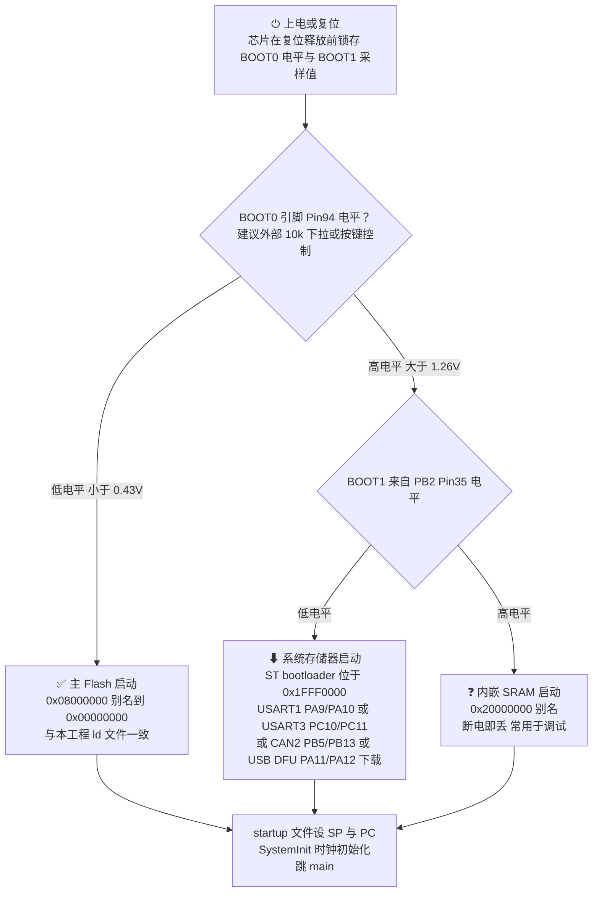

### 6.4 与本工程链接脚本对照

`STM32F407VGTx_FLASH.ld` 的 MEMORY 定义与数据手册内存映射（p.73）完全对应：

| ld 符号 | 地址/长度 | 手册依据 |
| --- | --- | --- |
| `FLASH (rx) : ORIGIN = 0x08000000, LENGTH = 1024K` | 用户 Flash 1 MB | p.73「Flash 0x0800 0000 - 0x080F FFFF」 |
| `RAM : ORIGIN = 0x20000000, LENGTH = 128K` | 主 SRAM 112+16 KB | p.73「SRAM 0x2000 0000 - 0x2001 FFFF」 |
| `CCMRAM : ORIGIN = 0x10000000, LENGTH = 64K` | CCM 数据 RAM | p.73「CCM data RAM 0x1000 0000 - 0x1000 FFFF（64 KB）」 |
| （隐含）系统 bootloader | `0x1FFF 0000 - 0x1FFF 7A0F` | p.73「System memory + OTP」；选项字节 `0x1FFF C000` |

---

## 7. 复用功能 AF0~AF15 映射

### 7.1 机制说明

每个 GPIO 有 4 位 AFR 字段选择 16 种复用功能之一（AF0~AF15）。与 F1 的「AFIO 重映射」不同，F4 是**每脚独立选 AF 编号**，同一外设的同一信号天然可落在多个脚上。AF 编号与外设组对应关系（**Table 9「Alternate function mapping」, DS8626 p.64-70**）：

| AF 编号 | 功能组 |
| :-: | --- |
| AF0 | 系统：MCO1/MCO2、JTMS-SWDIO、JTCK-SWCLK、JTDI、JTDO/TRACESWO、NJTRST、TRACECLK/TRACED0~3、RTC_REFIN |
| AF1 | TIM1 / TIM2 |
| AF2 | TIM3 / TIM4 / TIM5 |
| AF3 | TIM8 / TIM9 / TIM10 / TIM11 |
| AF4 | I2C1 / I2C2 / I2C3 |
| AF5 | SPI1 / SPI2 / I2S2 / I2S2ext |
| AF6 | SPI3 / I2S3 / I2S3ext |
| AF7 | USART1 / USART2 / USART3 / I2S3ext |
| AF8 | UART4 / UART5 / USART6 |
| AF9 | CAN1 / CAN2 / TIM12 / TIM13 / TIM14 |
| AF10 | OTG_FS / OTG_HS |
| AF11 | ETH（以太网 MAC） |
| AF12 | FSMC / SDIO |
| AF13 | DCMI（摄像头接口） |
| AF14 | 保留（F407 无定义） |
| AF15 | EVENTOUT（事件输出，把内部事件送到引脚） |

> ADC/DAC/OSC/WKUP/RTC_TAMPER 等**不占 AFR**，属于「附加功能」：把脚配成模拟模式/由外设寄存器直接接管即可（Table 6, p.48）。

### 7.2 常用外设可用引脚大表（仅列 LQFP100 引出的脚，依据 Table 7 p.49-61 + Table 9 p.64-70）

| 外设 | 信号 | 可用引脚（LQFP100） | AF |
| :-: | --- | --- | :-: |
| **USART1** | TX / RX | PA9 / PA10；PB6 / PB7 | AF7 |
| | CK / CTS / RTS | PA8 / PA11 / PA12 | AF7 |
| **USART2** | TX / RX | PA2 或 PD5；PA3 或 PD6 | AF7 |
| | CK / CTS / RTS | PD7；PA0 或 PD3；PA1 或 PD4 | AF7 |
| **USART3** | TX / RX | PB10 或 PD8；PB11 或 PD9 | AF7 |
| | CK / CTS / RTS | PB12 或 PD10；PB13 或 PD11；PB14 或 PD12 | AF7 |
| **USART6** | TX / RX | PC6 / PC7（LQFP100 上唯一选择） | AF8 |
| **UART4** | TX / RX | PA0 或 PC10；PA1 或 PC11 | AF8 |
| **UART5** | TX / RX | PC12；PD2 | AF8 |
| **I2C1** | SCL / SDA | PB6 或 PB8；PB7 或 PB9（SMBA=PB5） | AF4 |
| **I2C2** | SCL / SDA | PB10；PB11（SMBA=PB12） | AF4 |
| **I2C3** | SCL / SDA | PA8；PC9 | AF4 |
| **SPI1** | NSS / SCK / MISO / MOSI | PA4 或 PA15；PA5 或 PB3；PA6 或 PB4；PA7 或 PB5 | AF5 |
| **SPI2** | NSS / SCK / MISO / MOSI | PB9 或 PB12；PB10；PB14 或 PC2；PB15 或 PC3 | AF5 |
| **SPI3** | NSS / SCK / MISO / MOSI | PA4 或 PA15；PB3 或 PC10；PB4 或 PC11；PB5 或 PC12 | AF6 |
| **TIM1**（高级） | CH1~CH4 | PA8 或 PE9；PA9 或 PE11；PA10 或 PE13；PA11 或 PE14 | AF1 |
| | CH1N~CH3N | PA7 或 PE8；PE10；PE12 | AF1 |
| | BKIN / ETR | PA6 或 PE15 或 PB12；PA12 或 PE7 | AF1 |
| **TIM2** | CH1_ETR | PA0 或 PA5 或 PA15；CH2=PA1 或 PB3；CH3=PA2 或 PB10；CH4=PA3 或 PB11 | AF1 |
| **TIM3** | CH1~CH4 | PA6/PB4/PC6；PA7/PB5/PC7；PB0/PC8；PB1/PC9；ETR=PD2 | AF2 |
| **TIM4** | CH1~CH4 | PB6 或 **PD12**；PB7 或 PD13；PB8 或 PD14；PB9 或 PD15；ETR=PE0 | AF2 |
| **TIM5** | CH1~CH4 | PA0；PA1；PA2；PA3 | AF2 |
| **TIM8**（高级） | CH1~CH4 | PC6；PC7；PC8；PC9 | AF3 |
| | CH1N | PA5 或 PA7；CH2N=PB0 或 PB14；CH3N=PB1 或 PB15；BKIN=PA6；ETR=PA0 | AF3 |
| **TIM9 / TIM10 / TIM11** | CH1 / CH2 | TIM9：PA2 或 PE5、PA3 或 PE6；TIM10_CH1=PB8；TIM11_CH1=PB9 | AF3 |
| **TIM12 / TIM13 / TIM14** | CH1 / CH2 | TIM12：PB14、PB15；TIM13_CH1=PA6；TIM14_CH1=PA7 | AF9 |
| **CAN1** | RX / TX | PA11 或 PB8 或 PD0；PA12 或 PB9 或 PD1 | AF9 |
| **CAN2** | RX / TX | PB5 或 PB12；PB6 或 PB13 | AF9 |
| **USB OTG FS** | VBUS / ID / DM / DP / SOF | PA9；PA10；PA11；PA12；PA8 | AF10 |
| **USB OTG HS**（ULPI） | CK/STP/DIR/NXT/D0~D7 | PA5；PC0；PC2；PC3；PA3、PB0~PB2? 无——D0=PA3、D1=PB0、D2=PB1、D3=PB10、D4=PB11、D5=PB12、D6=PB13、D7=PB5 | AF10 |
| **SDIO** | CK / CMD / D0~D7 | PC12；PD2；PC8、PC9、PC10、PC11、PB8、PB9、PC6、PC7 | AF12 |
| **ETH**（RMII/MII） | 常用信号 | MDC=PC1、MDIO=PA2、REF_CLK=PA1、CRS=PA0/PA7、RXD0=PC4、RXD1=PC5、TX_EN=PB11、TXD0=PB12、TXD1=PB13、TX_CLK=PC3、RX_ER=PB10、PPS_OUT=PB5 | AF11 |
| **ADC123**（附加功能） | IN0~IN15 | IN0~7=PA0~PA7；IN8/9=PB0/PB1；IN10~15=PC0~PC5 | 不占 AFR |
| **DAC**（附加功能） | OUT1 / OUT2 | PA4 / PA5 | 不占 AFR |
| **MCO** | MCO1 / MCO2 | PA8 / PC9 | AF0 |
| **DCMI**（AF13） | D0~D11、HSYNC、VSYNC、PIXCLK | 分散在 PA4/PA9/PA10、PB5~PB9、PC6~PC12、PD2、PE0/PE1/PE4~PE6 | AF13 |

> 📌 选脚建议：优先选「该脚复用项少」的组合（如 USART1 用 PA9/PA10、I2C1 用 PB6/PB7），把复用拥挤的脚（PB12/PB13/PA15/PB3）留到实在没脚时再用。所有 USART TX/RX、SPI、I2C 的引脚均为 FT 结构，3.3 V 电平；接 5V 设备见第 9 章注意事项。

---

## 8. 调试口：SWJ-DP（PA13/PA14/PA15/PB3/PB4）

### 8.1 调试引脚与 AF0

F4 的调试端口（SWJ-DP）支持两种协议，引脚复用为 **AF0**（Table 7, p.57-60）：

| 引脚 | JTAG 功能 | SWD 功能 | LQFP100 引脚号 | 复位后状态 |
| :-: | --- | --- | :-: | --- |
| PA13 | JTMS | **SWDIO** | 72 | AF0；SWD 模式下带内部上拉（RM0090 GPIO 章） |
| PA14 | JTCK | **SWCLK** | 76 | AF0；SWD 模式下带内部下拉（RM0090） |
| PA15 | JTDI | —（SWD 不用） | 77 | AF0 + 上拉 |
| PB3 | JTDO / TRACESWO | SWO（可选） | 89 | AF0 |
| PB4 | NJTRST | —（SWD 不用） | 90 | AF0 + 上拉 |

复位后 SWJ-DP 默认启用且为 **JTAG+SWD 混合**状态——所以 PA15/PB3/PB4 复位后不是普通 GPIO，**点灯没反应的第一嫌疑就是误用了这五个脚**。

### 8.2 释放方法（把 PA15/PB3/PB4 还给用户）

SWD 只需 PA13+PA14（+可选 PB3 作 SWO）。要释放 PA15/PB3/PB4：

```c
/* 方法一：HAL——直接重新初始化为 GPIO（写 MODER 即可脱离 AF0） */
GPIO_InitTypeDef g = {0};
__HAL_RCC_GPIOA_CLK_ENABLE();
g.Pin = GPIO_PIN_15;  g.Mode = GPIO_MODE_OUTPUT_PP;  g.Pull = GPIO_NOPULL;
HAL_GPIO_Init(GPIOA, &g);          /* PA15 变推挽输出 */

__HAL_RCC_GPIOB_CLK_ENABLE();
g.Pin = GPIO_PIN_3 | GPIO_PIN_4;
HAL_GPIO_Init(GPIOB, &g);          /* PB3/PB4 释放 */

/* 方法二：寄存器级（等价） */
RCC->AHB1ENR  |= RCC_AHB1ENR_GPIOAEN | RCC_AHB1ENR_GPIOBEN;
GPIOA->MODER  |=  (1UL << (15 * 2));   /* PA15 MODER=01 输出，脱离 AF0 */
GPIOB->MODER  |=  (1UL << (3 * 2)) | (1UL << (4 * 2));
```

> ⚠️ 千万不要把 PA13/PA14 也配成普通 GPIO——那样 SWD 下载/调试立即断开，只能靠 BOOT0 进 bootloader 的串口/USB DFU 救砖。工程上稳妥做法：PB3 需要当 GPIO 时改用「SWD only」（PA13/PA14 保留），或者干脆换 PB10 之类的脚。

---

## 9. 电气特性

### 9.1 电源与电压（DS8626 §6.2-6.3, p.80-82）

| 参数 | 值 | 出处 |
| --- | --- | :-: |
| VDD 工作范围 | **1.8 ~ 3.6 V**（3.3 V 典型）；1.7 V 下限需外部电源监视器 + 降额温度范围 | Table 14, p.81 |
| VDDA | 1.8~2.4 V（ADC 限 1.2 Msps）或 2.4~3.6 V（ADC 限 1.4 Msps）；与 VDD 同源，上/掉电期间压差 ≤300 mV；VDDA−VREF+ < 1.2 V | Table 14 注 4/5, p.82 |
| VBAT | 1.65~3.6 V（RTC/备份寄存器/LSE 供电，经电源开关） | Table 14, p.81 |
| 内核 V12（VCAP_1/2 上） | Scale1：1.20~1.32 V（168 MHz）；Scale2：1.08~1.20 V（144 MHz） | Table 14, p.82 |
| FT 脚输入电压 | 工作时 **VDD ≥2 V：−0.3 ~ 5.5 V**；VDD <2 V：−0.3 ~ 5.2 V（内部上下拉必须禁用） | Table 14, p.82 |
| TTa 脚（PA4/PA5） | −0.3 ~ VDDA+0.3 V（**不可接 5V**） | Table 14, p.82 |
| BOOT0（B 类） | ≤5.5 V（专用 BOOT 脚有独立耐压） | Table 14, p.82 |
| 绝对最大 | VDD−VSS：−0.3~4.0 V；FT 脚输入 −0.3~VDD+4.0 V；其他脚 −0.3~4.0 V；ΔVDDx ≤50 mV | Table 11, p.80 |
| LQFP100 最大功耗 | 465 mW（TA=85 °C，6 后缀） | Table 14, p.82 |

### 9.2 电流能力（Table 12, p.81 + p.118 输出驱动说明）

| 参数 | 值 | 说明 |
| --- | :-: | --- |
| 每个 I/O 灌/拉电流（绝对最大） | **±25 mA** | 不可持续，需满足 VOH/VOL 规格 |
| 每个 I/O 标称驱动 | **±8 mA**（VOL≤0.4 V，VOH≥VDD−0.4 V） | Table 49, p.118 |
| 每个 I/O 宽裕驱动 | ±20 mA（VOL≤1.3 V，VOH≥VDD−1.3 V） | 电平余量换电流 |
| ΣIVDD / ΣIVSS（全部脚总和） | 240 mA / 240 mA | 含 MCU 运行电流 |
| **PC13、PC14、PC15** | **±3 mA，输出 ≤2 MHz，负载 ≤30 pF** | 经备份域电源开关供电，手册明文「不得用作电流源（如驱动 LED）」 |
| 注入电流 | FT 脚 −5/+0 mA（不能正向注入）；其他脚 ±5 mA；总和 ±25 mA | Table 12 注 2-5 + Table 47, p.115-116 |
| 内部弱上拉/下拉 | 30~50 kΩ，典型 40 kΩ；PA10/PB12 为 7~14 kΩ（OTG ID 相关） | Table 48, p.117 |
| I/O 输入漏电流 | ±1 µA；FT 脚 VIN=5 V 时 ≤3 µA | Table 48, p.116-117 |
| 输入电容 CIO | ≤5 pF | Table 48, p.117 |
| 施密特滞回 | ≥10% VDD（最小 200 mV）；BOOT0 滞回 0.1 V | Table 48, p.116-117 |

### 9.3 FT（5V 容忍）机制与使用规则

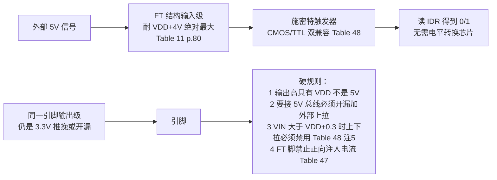

要点：

1. **FT = 输入耐 5V**，不是输出 5V。输出高电平永远是 VDD（3.3 V）。
2. 与 5V 器件「线与/多驱动」总线（如 5V I2C）通信：**开漏输出 + 外部上拉到 5V**，同时禁用内部上拉/下拉（Table 48 注 5 明确要求 VIN>VDD+0.3 时禁上下拉）。
3. 80 个 FT 脚里**不含 PA4/PA5**（TTa，直连 ADC/DAC）——这两脚接 5V 直接损坏。
4. NRST 也按 FT 规格耐压（Table 14「RST and FT pins」, p.82）。

### 9.4 NRST 引脚（§6.3.17, p.121）

| 参数 | 值 |
| --- | :-: |
| 内部弱上拉 RPU | 30~50 kΩ（典型 40 kΩ） |
| VIL / VIH（2.7~3.6 V） | ≤0.8 V / ≥2.0 V |
| 施密特滞回 | 200 mV |
| 内部滤波 | <100 ns 脉冲被滤除；≥300 ns 保证识别（VDD>2.7 V） |
| 内部复位脉冲宽度 | 20 µs |
| 推荐外部电路 | NRST 对地 0.1 µF；调试器复位线兼容 |

---

## 10. 上电复位与 BOR/PVD

### 10.1 上电复位链路

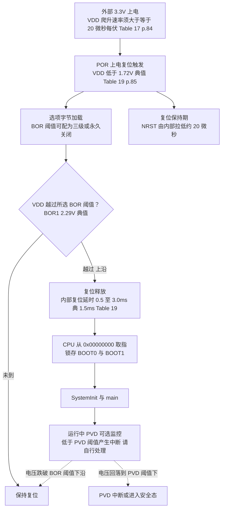

### 10.2 阈值数据表（Table 19「Embedded reset and power control block characteristics」, p.85-86）

| 监控项 | 条件 | 下降沿（V） | 上升沿（V） |
| --- | --- | :-: | :-: |
| POR/PDR | 固定 | 1.60 / 1.68 / 1.76（min/typ/max） | 1.64 / 1.72 / 1.80 |
| PDR 滞回 | 固定 | — | 40 mV |
| BOR 级 1 | 选项字节 | 2.13 / 2.19 / 2.24 | 2.23 / 2.29 / 2.33 |
| BOR 级 2 | 选项字节 | 2.44 / 2.50 / 2.56 | 2.53 / 2.59 / 2.63 |
| BOR 级 3 | 选项字节 | 2.75 / 2.83 / 2.88 | 2.85 / 2.92 / 2.97 |
| BOR 滞回 | — | — | 100 mV |

**PVD 可编程阈值**（PWR->PWR_CR 的 PLS[2:0]，Table 19, p.85；上/下沿差即 100 mV 滞回）：

| PLS[2:0] | 000 | 001 | 010 | 011 | 100 | 101 | 110 | 111 |
| :-: | :-: | :-: | :-: | :-: | :-: | :-: | :-: | :-: |
| 上升沿典型（V） | 2.14 | 2.30 | 2.45 | 2.60 | 2.76 | 2.93 | 3.03 | 3.14 |

其他关键数字：

| 参数 | 值 | 出处 |
| --- | :-: | :-: |
| 复位保持延时（POR 或 Standby 唤醒后） | 0.5~3.0 ms，典型 1.5 ms | Table 19, p.86 |
| 稳压器上电浪涌电流 | 160~200 mA，能量 5.4 µC | Table 19, p.86 |
| VDD 上升/下降速率 | ≥20 µs/V（太快 POR 可能不动作） | Table 17, p.84 |
| VCAP 外部电容 | **2.2 µF、ESR<2 Ω**（regulator OFF 时改 100 nF） | Table 16, p.84 |
| VBAT 监测 | 内部 50 kΩ 分压桥（÷2 后进 ADC1_IN18，LSI 通道） | Table 71, p.141 |
| VREFINT 内部基准 | 1.21 V 典型（±30~50 ppm/°C），校准值在 `0x1FFF 7A2A` | Table 72/73, p.141 |

---

## 11. 如何使能一个 GPIO

同一个目的有三种抽象层级。**本仓库 `MX_GPIO_Init`（main.c 第 56~64 行）用的是 HAL 层**。

### 11.0 先理解「使能」的完整步骤

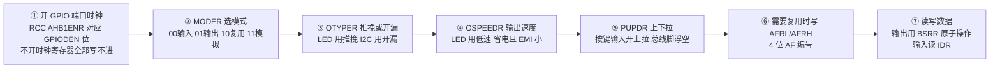

### 11.1 HAL 级（本工程 main.c 逐行讲）

```c
/* LED GPIO 初始化：PD12 —— 摘自本仓库 Core/Src/main.c */
static void MX_GPIO_Init(void) {
    GPIO_InitTypeDef g = {0};
    __HAL_RCC_GPIOD_CLK_ENABLE();        /* ← 步骤①：AHB1ENR 的 GPIODEN 位置 1 */
    g.Pin   = LED_Pin;                   /* GPIO_PIN_12（main.h） */
    g.Mode  = GPIO_MODE_OUTPUT_PP;       /* ← 步骤②③：MODER=01 输出 + OTYPER=0 推挽 */
    g.Pull  = GPIO_NOPULL;               /* ← 步骤⑤：PUPDR=00 无上下拉 */
    g.Speed = GPIO_SPEED_FREQ_LOW;       /* ← 步骤④：OSPEEDR=00 低速（LED 足够） */
    HAL_GPIO_Init(LED_GPIO_Port, &g);    /* 一次性写入 GPIOD 的 MODER/OTYPER/OSPEEDR/PUPDR */
}
```

`HAL_GPIO_Init` 内部做的事（可读 `Drivers/STM32F4xx_HAL_Driver/Src/stm32f4xx_hal_gpio.c`）：按 pin 逐位清/置 MODER、OSPEEDR、PUPDR、OTYPER；若 Mode 是 AF 类再写 AFRH/AFRL；若是 EXTI 模式再配 SYSCFG_EXTICR。**它不会替你开 GPIO 时钟**——所以工程里先有一行 `__HAL_RCC_GPIOD_CLK_ENABLE()`。

点灯/翻转：

```c
HAL_GPIO_WritePin(GPIOD, GPIO_PIN_12, GPIO_PIN_SET);     /* BSRR 写 1<<12 置高 */
HAL_GPIO_WritePin(GPIOD, GPIO_PIN_12, GPIO_PIN_RESET);   /* BSRR 写 1<<28 清低 */
HAL_GPIO_TogglePin(GPIOD, GPIO_PIN_12);                  /* 读 ODR 后写 BSRR 翻转 */
```

### 11.2 寄存器级（完整等价片段，理解硬件）

```c
/* ============ PD12 输出 LED：纯寄存器版本 ============ */
/* ① 开 GPIOD 时钟 */
RCC->AHB1ENR |= RCC_AHB1ENR_GPIODEN;
(void)RCC->AHB1ENR;                          /* 读回一次，确保时钟已生效 */

/* ② 模式：MODER12 = 01（通用输出）。MODER 每 2 位管一个脚，脚 12 占 bit[25:24] */
GPIOD->MODER  &= ~(3UL << (12 * 2));         /* 先清零（复位值本就是 00，防御性写法） */
GPIOD->MODER  |=  (1UL << (12 * 2));         /* 01 = 输出 */

/* ③ 类型：OTYPER12 = 0（推挽） */
GPIOD->OTYPER &= ~(1UL << 12);

/* ④ 速度：OSPEEDR12 = 00（低速，2~8MHz 足够 LED） */
GPIOD->OSPEEDR &= ~(3UL << (12 * 2));

/* ⑤ 上下拉：PUPDR12 = 00（无） */
GPIOD->PUPDR  &= ~(3UL << (12 * 2));

/* ⑦ 输出：BSRR 原子置位/清零（不要读改写 ODR） */
GPIOD->BSRR = (1UL << 12);                   /* 置高：亮 */
GPIOD->BSRR = (1UL << (12 + 16));            /* 清低：灭（高 16 位写 1 清零） */

/* 输入 + 上拉示例（按键 PA0）：
   RCC->AHB1ENR |= RCC_AHB1ENR_GPIOAEN;
   GPIOA->MODER &= ~(3UL << (0 * 2));          00 = 输入
   GPIOA->PUPDR |=  (1UL << (0 * 2));          01 = 上拉（配外部下拉按键）
   level = (GPIOA->IDR >> 0) & 1UL;            读 IDR                                    */
```

要点解释：

1. **BSRR 为什么是原子操作**：写 1 的位立即生效，其他位不受影响，不需要「读-改-写」三步——在 FreeRTOS 任务/中断里并发访问同一端口时必须用它，避免丢翻转。
2. **LCKR 锁定**：`GPIOx->LCKR` 用 `1→0→1→读→0` 序列写 LCKK 后，该口配置被冻结直到复位——防误写跑飞场景用。
3. 复用脚才需要第⑥步写 AFR；纯 GPIO 输出只动 MODER 就够了（AF 编号复位后不定，但 MODER=01 时 AFR 不参与）。

### 11.3 LL 库 / Arduino 风格简述

```c
/* LL 库（stm32f4xx_ll_gpio.h + ll_rcc.h）：比 HAL 轻量、直接映射寄存器 */
LL_AHB1_GRP1_EnableClock(LL_AHB1_GRP1_PERIPH_GPIOD);
LL_GPIO_SetPinMode(GPIOD, LL_GPIO_PIN_12, LL_GPIO_MODE_OUTPUT);
LL_GPIO_SetPinOutputType(GPIOD, LL_GPIO_PIN_12, LL_GPIO_OUTPUT_PUSHPULL);
LL_GPIO_SetPinSpeed(GPIOD, LL_GPIO_PIN_12, LL_GPIO_SPEED_FREQ_LOW);
LL_GPIO_SetPinPull(GPIOD, LL_GPIO_PIN_12, LL_GPIO_NO_PULL);
LL_GPIO_TogglePin(GPIOD, LL_GPIO_PIN_12);
```

```cpp
/* Arduino-STM32（STM32duino）风格：一条语句完成全部初始化 */
pinMode(PD12, OUTPUT);
digitalWrite(PD12, HIGH);
digitalToggle(PD12);
```

---

## 12. Blink 实战：本仓库 main.c 的 PD12 深度分析

### 12.1 完整链路：从上电到 LED 闪烁

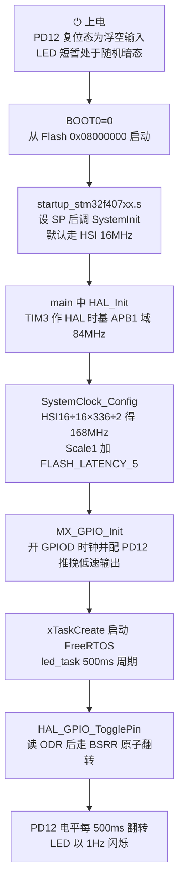

`MX_GPIO_Init` 的初始化动作流：

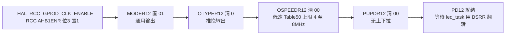

### 12.2 PD12 深度分析

| 维度 | 分析 |
| --- | --- |
| 复用冲突 | PD12 同时承载 **TIM4_CH1（AF2）**、USART3_RTS（AF7）、FSMC_A17（AF12）、EVENTOUT（AF15）（Table 7, p.55）。本工程把 MODER 设为 01（GPIO 输出），AFR 不参与，**不会**误触发定时器——但如果你用 CubeMX/手写把 PD12 配成 AF 模式或使能了 FSMC，LED 会跟着 TIM4/FSMC 波形乱闪。`HAL_GPIO_Init` 只写所选模式的寄存器、不清 AFR，换脚复用时记得显式处理。 |
| 5V 容忍 | PD12 是 **FT** 脚：输入可耐 5 V（接 5V 逻辑传感器信号没问题）；输出仍为 3.3 V。 |
| 驱动能力 | 绝对最大 ±25 mA；标称 ±8 mA 时 VOL≤0.4 V / VOH≥VDD−0.4 V（Table 49, p.118）。Discovery 板 LED 经限流电阻驱动，实际电流仅几 mA，余量充足。 |
| 上电行为 | 复位到 `MX_GPIO_Init` 之间 PD12 是浮空输入，LED 无驱动电流保持暗态；配成推挽后到 led_task 首次翻转前电平为 0（ODR 复位值 0），即**先灭后按 1Hz 闪**。若要求上电即亮，可在 init 后先 WritePin SET。 |
| 与 TIM4 的联动彩蛋 | 想用硬件 PWM 呼吸灯：把 PD12 配成 AF2（TIM4_CH1），TIM4 时钟 84 MHz（APB1 定时器倍频），完全不用 CPU 参与。Board 上 PD12/13/14/15 恰好是 TIM4 的 CH1~CH4——ST 官方例程用 TIM4 PWM 同时调四色灯正是这个原理。 |
| 换脚建议 | 任意未占用的 FT 脚都能当 LED 输出。推荐候选：PD13/14/15（同排另三只 Discovery LED）、PB0/PB1（相邻好走线）、PE8~PE15（底部一整排空闲脚）。**避免**：PC13~PC15（3 mA 且禁驱动 LED）、PA13/PA14（SWD）、PA15/PB3/PB4（JTAG 默认占用）、BOOT0（Pin 94）。 |

改动方法（裸机 HAL）：把 `Core/Inc/main.h` 的 `LED_GPIO_Port` 改成目标端口（如 `GPIOB`）、`LED_Pin` 改成 `GPIO_PIN_0`，再把 `MX_GPIO_Init` 里的 `__HAL_RCC_GPIOD_CLK_ENABLE()` 换成对应端口时钟宏（`__HAL_RCC_GPIOB_CLK_ENABLE()`）即可，其余代码不动。

---

## 13. 常见坑 FAQ

**Q1：VCAP_1/VCAP_2（Pin 49/73）是干嘛的？不接电容会怎样？**
它们是内部 1.2 V 内核稳压器的输出，**必须各接 1 颗 2.2 µF 陶瓷电容到 GND（ESR < 2 Ω，Table 16, p.84）**。悬空或容值不对会导致内核供电失稳：不上电、随机复位、跑一会儿死机。这是 F407 硬件第一坑。稳压器上电浪涌达 160~200 mA（Table 19, p.86），电容质量差也会出问题。

**Q2：BOOT0（Pin 94）悬空可以吗？**
不行。BOOT0 不是 GPIO、无内部上下拉，悬空电平随机，可能一次进 Flash 一次进 bootloader。**必须硬接线**：接地（10 kΩ 下拉）= 总是 Flash 启动；接按键/跳线到 VDD = 烧录模式。另注意 BOOT0 禁止电流注入（Table 47, p.116），别给它接会倒灌的电路。

**Q3：PB2 到底是不是 BOOT1？**
以数据手册为准：Table 7（p.52）中该脚名称写作 **`PB2/BOOT1`**——F4 系列的 BOOT1 电平由 PB2 引脚提供（复位时采样）。但它同时是普通 FT GPIO（主功能 PB2）。实际影响很小：**BOOT0=0 时无论 PB2 是什么电平都从主 Flash 启动**。数据手册正文没有 nBOOT1 选项字节的描述，BOOT1 机制细节以 RM0090 §2.6 为准。

**Q4：VDDA/VSSA/VREF+（Pin 20/21/22）能不能不接？**
不能。手册 Table 11 注 1（p.80）明确要求所有 VDD/VDDA/VSS/VSSA 必须接电源。VDDA 不供则 ADC、PLL（部分模拟电路）、POR/PDR/BOR 监控都受影响；VDDA 与 VDD 上电压差须 ≤300 mV（Table 14 注 5, p.82）。最少做法：VDDA 接 VDD、VSSA 接 VSS，各加 1 个 10 nF+1 µF 去耦；VREF+ 同 VDDA。

**Q5：PD12 写了输出代码但 LED 不闪？**
按顺序排查：① `__HAL_RCC_GPIOD_CLK_ENABLE()` 在 HAL_GPIO_Init 之前调用了吗（没时钟 = 寄存器写不进）；② 是不是误用了 PA13/PA14/PA15/PB3/PB4（复位后是调试 AF0）；③ 目标脚是不是 PC13~PC15（3 mA 且手册禁止驱动 LED）；④ 引脚号↔物理脚对不对（对照第 2 章布局图，例如 PD12 是 Pin 59）；⑤ ODR 写法——用 BSRR 别读改写 ODR。

**Q6：FT 脚接 5V 就万事大吉了？**
不是。FT 只是**输入**耐 5 V（绝对最大 VDD+4.0 V，Table 11, p.80；工作上限 5.5 V 且要求 VDD≥2 V，Table 14, p.82）。三条铁律：输出高电平仍只有 VDD；需要输出 5V 电平必须**开漏 + 外部上拉到 5V**；VIN 超过 VDD+0.3 V 时**内部上下拉必须禁用**（Table 48 注 5, p.117）。另外 PA4/PA5 是 TTa，**不是** FT，接 5V 直接损坏。

**Q7：APB1 上的外设能跑 84 MHz 吗？**
不能。APB1 上限 **42 MHz**、APB2 上限 **84 MHz**（Table 14, p.81）——168 MHz 的系统必须 APB1=HCLK/4。但挂在 APB1 的**定时器**时钟是 2×PCLK1=84 MHz（分频≠1 时自动倍频），TIM2~TIM5 的 PWM 分辨率并不受损。本工程 HAL 时基 TIM3 就是 84 MHz 计数。

**Q8：为什么 168 MHz 必须配 FLASH_LATENCY_5 和 Scale1？**
Flash 访问在 150~168 MHz 区间需要 5 个等待周期（§6.3.6, p.86；Table 15, p.83：VDD 2.7~3.6 V 时 168 MHz=5WS）；同时 fHCLK≤168 MHz 只在 VOS=1（Scale 1，内核 1.20~1.32 V）成立，VOS=0 上限 144 MHz（Table 14, p.81）。三者缺一：等待周期少了会取指错误，Scale 没切到 1 就是超频运行。

**Q9：PLLQ 分频出来的 48 MHz 是给谁的？给 USB 用错会怎样？**
PLLQ 输出（本工程 336/7=48 MHz）是 USB OTG FS、SDIO、RNG 的时钟源。USB 规范要求精确 48 MHz（±0.25% 级），所以：用 USB 时要么 HSE 晶振（精度高），要么接受 HSI 的 ±1%（25 °C）/±4%（全温）误差——**HSI 驱动 USB 在温度变化下可能超差**。本工程不用 USB，PLLQ=7 只是顺手保持规范值（PLL48_OUT≤48 MHz，Table 36, p.106）。

**Q10：OSPEEDR 该怎么选？全设超高速不行吗？**
行是行，但有害无益：速度档越高边沿越陡（Table 50, p.119-120：低速 100 ns → 超高速 2.5 ns @50 pF），EMI/串扰/过冲都变差，功耗也升。规则：GPIO 控制信号/LED 用低速；SPI/PB10 以上的 I2C 快速线用中速；SDIO/高速 FSMC 用高速；>50 MHz 输出需启用补偿单元（SYSCFG_CMPCR）。本工程 LED 用 `GPIO_SPEED_FREQ_LOW` 是教科书式正确。

**Q11：想用 PA0 做按键，为什么唤醒/EXTI 有讲究？**
PA0 是唯一 WKUP 脚（Standby 唤醒），也是 EXTI0 线。Discovery 板按键按下接地——配输入+内部上拉（PUPDR=01）即可读 IDR。注意 PA0 还有 ADC123_IN0、TIM2_CH1 等复用，别在 ADC 扫描时把按键脚配成模拟模式。

**Q12：NRST 要不要外部复位芯片/RC？**
NRST 内部已有 40 kΩ 上拉 + 100 ns 滤波（Table 51, p.121），一般外接 0.1 µF 到 GND 即可。手册要求 VDD 爬升 ≥20 µs/V（Table 17, p.84）——电源太快时 POR 可能失效，慢速上电（LDO 软启动）反而安全。手动复位键直接并联在 NRST-GND 之间即可（低有效）。

**Q13：HSE 起振失败/起振慢？**
HSE 晶振 4~26 MHz 接 PH0/PH1（Pin 12/13），负载电容按晶振 CL 参数配（CL1=CL2≈2×(CL−Cstray)，Cstray 估 10 pF，Table 32 注, p.103-104，详见 AN2867）；典型起振 2 ms，代码里要等 HSERDY 标志再切 PLL 源（HAL_RCC_OscConfig 已处理）。起振不稳多半是电容不匹配或晶振布局离芯片太远。注意本工程用的是 HSI，完全绕开了这个问题——代价是精度（±1% @25 °C）。

**Q14：PB6/PB7 接了 I2C 上拉后还能当 USART1 用吗？**
能，但要重配：I2C 要求开漏+外部上拉，USART1 TX 要推挽。同一脚同一时刻只有一个 AF 生效（AFR 只有一个值），切外设时连 OTYPER 一起改。另外 I2C 上拉电阻（2.2~4.7 kΩ）在切回 UART 后会拖慢边沿，高速率时去掉。

**Q15：注入电流限制到底怎么防？**
FT 脚**禁止正向注入**（VIN>VDD，-5/+0 mA，Table 12/47）；PC0~PC3、PB6~PB9、PE0~PE6、PC13~PC15、PH0/PH1 等脚禁止**负向注入**（Table 47, p.116，共 28 脚——它们的 ESD 结构更敏感）。接电感/电机反电动势、负压信号的场合加钳位二极管或串联电阻；手册还建议模拟脚（ADC 输入）对地加肖特基二极管防负注入（Table 47 注 1）。

---

> 📚 延伸阅读：GPIO 位级行为见《STM32F4xx 参考手册》RM0090 第 8 章（GPIO）与第 6 章（RCC）；硬件布局规范见 AN4488《Getting started with hardware development tools for the STM32F407/417》；GPIO 配置与低功耗见 AN4899；晶振设计见 AN2867；bootloader 协议细节见 AN2606（System memory boot mode）。
